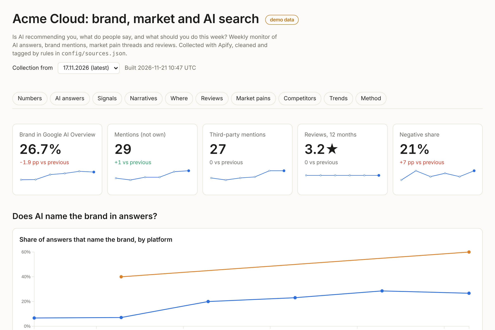

# Social Listening Monitor

**Is AI recommending your brand? Find out every week, along with what people say about you everywhere else.**

An open-source alternative to paid social listening tools, with AI search visibility built in. Apify collects the data, Python cleans and tags it, and a static page on GitHub Pages shows what changed and what to do about it. Runs for a few dollars a month.

**[Live demo →](https://paulythemarketer-source.github.io/social-listening-monitor/)** (fictional SaaS brand "Acme Cloud", generated data)



## Start with AI search

Buyers now ask ChatGPT, Gemini and Google AI Overview for a shortlist before they ever open your site. If AI doesn't name you, you're not on the list, and no analytics tool will tell you.

Every week the monitor asks AI the questions your buyers ask and shows:

- the share of answers that name your brand, by platform, with the trend;
- which prompts you win and which you lose;
- where your own site ranks in the regular results for the same prompts.

## What it solves

**1. The numbers: is it getting better or worse?**
AI visibility, mentions, third-party share, review score and negative share in one row, each with its trend across weekly collections.

**2. The narratives: what are people actually talking about?**
Not just how many mentions, but which topics they are about (pricing, reliability, support, integrations…), how negative each topic is and on which platforms it lives. Next to that, brand-free market pain threads and the competitors people blame.

**3. The conclusions: what should we do this week?**
Signals flag what needs a reaction: a negative mention, a review spike, unanswered reviews, a drop in AI share, a pain topic that is growing. Takeaways turn the data into actions. Connect Jira, and every action becomes a ticket automatically.

## Who it's for

B2B teams that sell on trust and can't afford to hear about a problem from a lost deal.

| Team | What it catches | What you do with it |
|---|---|---|
| Fintech | Complaints about blocked accounts, slow payouts and hidden fees; threads asking for an alternative to a big provider | Reply before it spreads, feed support FAQs, build pages and ads around the exact pain |
| SaaS | Outage and price-change backlash, "X alternative" threads, missing-integration requests | Comparison and win-back pages, roadmap input, competitor campaigns |
| Legal and professional services | Reviews and forum questions about firms in your practice area; which firms AI assistants recommend | Reputation response, content for the questions people actually ask, AI visibility work |
| Any B2B | Who writes about you, what the market complains about, whether AI names you | One weekly page for marketing, sales and support |

## How it helps

- **React in days, not quarters.** A negative mention or a review spike shows up the same week, not when a prospect brings it up on a call.
- **Write in the customer's words.** Pain threads give you real phrasing for headlines, FAQs and ad copy.
- **Know what competitors get blamed for.** Positioning and "alternative" campaigns start from evidence, not guesses.
- **Prove AI visibility work.** See whether AI names you before and after you change content.
- **Arm sales.** Fresh objections and quotes for battlecards every week.
- **Pay for data, not seats.** Rules plus a scraper instead of a $100+ monthly subscription.

## Case: built for a B2B brand

**Problem.** A B2B brand had no single view of what the market said about it. Mentions were scattered across Google, Reddit, X, LinkedIn and review sites; paid listening tools were expensive and noisy; and nobody knew whether AI assistants named the brand at all.

**Approach.** Weekly Apify collection, keyword rules instead of black-box scoring, one static page with numbers, narratives and actions, and a fixed list of buyer prompts checked in AI answers.

**Result.** One page the team reads every week: what changed, what people talk about, which prompts AI answers without the brand, and a short list of actions for marketing, support and sales.

## From dashboard to Jira

Connect Jira, and each week's signals turn into tasks: respond to a negative mention, reply to unanswered reviews, brief a page on a growing pain topic, update pages for prompts where AI stopped naming you. Each task links to the source posts and is created once, never duplicated.

Add four secrets to the repo: `JIRA_BASE_URL`, `JIRA_EMAIL`, `JIRA_API_TOKEN`, `JIRA_PROJECT_KEY`. Preview the tasks without Jira: `python scripts/to_jira.py --dry-run`.

## What the dashboard shows

| Block | Question it answers |
|---|---|
| Numbers | AI visibility, mentions, third-party share, review score and negative share, each with its trend |
| AI answers | Share of prompts where AI names the brand, by platform; prompts won and lost |
| Signals | Negative mentions, spam, unanswered reviews, review spikes, drops in AI share, growing pain topics |
| Takeaways | What the data means and what to do next |
| Narratives | Topics people discuss when they mention the brand, and how negative each one is |
| Where | Mentions by platform and industry, with own posts, listings and spam tagged |
| Reviews | Monthly volume, negative spikes (mean + 2σ), negative vs positive themes |
| Market pains | Brand-free threads by pain cluster and platform: where demand sits |
| Competitors | Who gets named in complaints, and what they get blamed for |

## How it works

```
Apify tasks (weekly)  →  scripts/fetch.py   →  data/raw/*.json  (history)
                                                ↓
config/sources.json   →  scripts/build.py   →  docs/data.json  →  docs/index.html (GitHub Pages)
                                                ↓
                         scripts/to_jira.py →  Jira tasks (optional)
```

- **Collection:** public Apify actors for Google Search, Reddit, X and LinkedIn. AI Overview checks use the Google Search scraper on a fixed prompt list.
- **Cleaning and tagging:** plain keyword rules in `config/sources.json`: brand pattern, noise, own posts, spam, listings, negative words, industries, narratives, pain clusters, competitors. Rules on purpose, so every tag can be explained.
- **Dashboard:** one static HTML file. No backend, no build step.
- **Schedule:** a GitHub Action runs weekly, pulls the last Apify runs, rebuilds the data, sends tasks to Jira and commits.

## Set it up without code

1. Click **Fork** at the top of this page to copy the repo to your account.
2. In your copy, open **Settings → Pages**, choose **Deploy from a branch**, branch `main`, folder `/docs`, **Save**. The demo goes live in a minute.
3. Open `config/sources.json`, click the pencil icon and change the brand name, your domain, competitors and rules. **Commit changes**.
4. In Apify, create one task per source with your queries (examples are in `query_templates`). Copy each task ID.
5. In **Settings → Secrets and variables → Actions**, add `APIFY_TOKEN` and the task IDs (`TASK_GOOGLE`, `TASK_REDDIT`, …). Add the Jira secrets if you want tickets.
6. Open **Actions → Weekly collection → Run workflow**. The page switches from demo to live data.

Run it locally instead:

```bash
python scripts/make_demo.py   # regenerate demo data
python scripts/build.py       # build docs/data.json
cd docs && python -m http.server
```

## Cost

Apify charges per result, so the bill depends on how many queries and sources you run. A weekly run of four brand sources, two pain sources and a short AI prompt list fits within the Apify free plan's monthly credit. Set a spending cap per task. GitHub Actions and Pages are free for public repos.

## Notes

- The demo brand, competitors, people and texts are invented. URLs use the reserved `.example` domain.
- Rule-based tagging is a deliberate choice: cheap, repeatable and easy to audit. Swap in an LLM classifier if you need nuance.

---

Built by **Polina Lebedev**, product marketer: B2B go-to-market, GEO and AI visibility.
